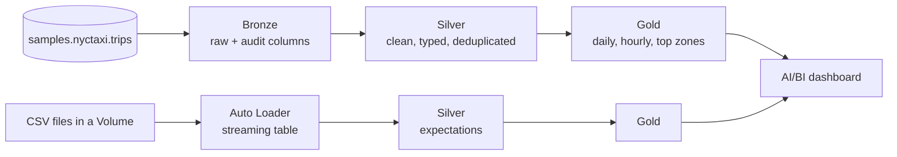

# Databricks Taxi Lakehouse

End-to-end data engineering project on **Databricks Free Edition**. Raw NYC taxi trips are ingested, cleaned and aggregated using the **medallion architecture** (bronze, silver, gold), orchestrated with **Databricks Jobs**, rebuilt as a **Declarative ETL pipeline** with Auto Loader and data-quality expectations, and served through an **AI/BI dashboard**.

## Architecture



## Tech stack

Databricks Free Edition (serverless) | PySpark | Spark SQL | Delta Lake | Unity Catalog | Auto Loader | Jobs | Declarative Pipelines | AI/BI Dashboards | Git folders

## Project layers

| Layer | Table | What happens |
|---|---|---|
| Bronze | `bronze.trips_raw` | Raw copy plus `_ingested_at` and `_source` audit columns |
| Silver | `silver.trips` | Removes invalid fares, distances and durations, derives date and hour, removes duplicates |
| Gold | `gold.daily_summary`, `gold.hourly_demand`, `gold.top_pickup_zones` | Business aggregates for the dashboard |

## Orchestration

| Job | Tasks in order |
|---|---|
| `taxi_medallion_etl` | `bronze` -> `silver` -> `gold` -> `quality_checks` |
| `taxi_pipeline_job` | `land_files` -> `run_pipeline` |

## Data quality

- Silver rules: fare > 0, distance > 0, trip duration between 1 and 300 minutes, duplicates removed
- Pipeline expectations: `valid_fare`, `valid_distance`, `valid_duration`
- A quality-check notebook raises an error if any check fails, so the job never passes silently

## Repository structure

```
notebooks/     setup, bronze, silver, gold, quality checks, file landing
pipelines/     declarative ETL pipeline (SQL)
sql/           dashboard queries
docs/          architecture, data dictionary, GitHub guide
```

## How to run

1. Clone this repo into Databricks as a **Git folder** (Workspace -> Create -> Git folder).
2. Run `notebooks/00_setup` to create the catalog, schemas and volume.
3. Create the Job `taxi_medallion_etl` with the four notebook tasks above and click **Run now**.
4. Run `notebooks/10_land_files`, then create the ETL pipeline from `pipelines/taxi_etl_pipeline/transformations/taxi_pipeline.sql`.
5. Build the dashboard from `sql/dashboard_queries.sql`.

## Screenshots

Add your images to `docs/images/` and link them here:

- Job run graph
- Pipeline graph
- Dashboard

## Limitations

- Free Edition uses serverless compute only and has a daily usage quota
- Small static sample dataset, not production scale
- Managed ingestion connectors were not used

## What I learned

Medallion design, idempotent Delta writes, incremental ingestion with Auto Loader, declarative data quality, job orchestration, Unity Catalog naming, and version control with Git folders.
